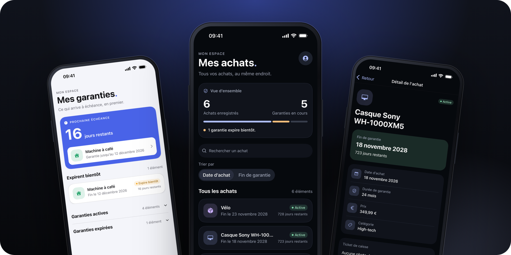
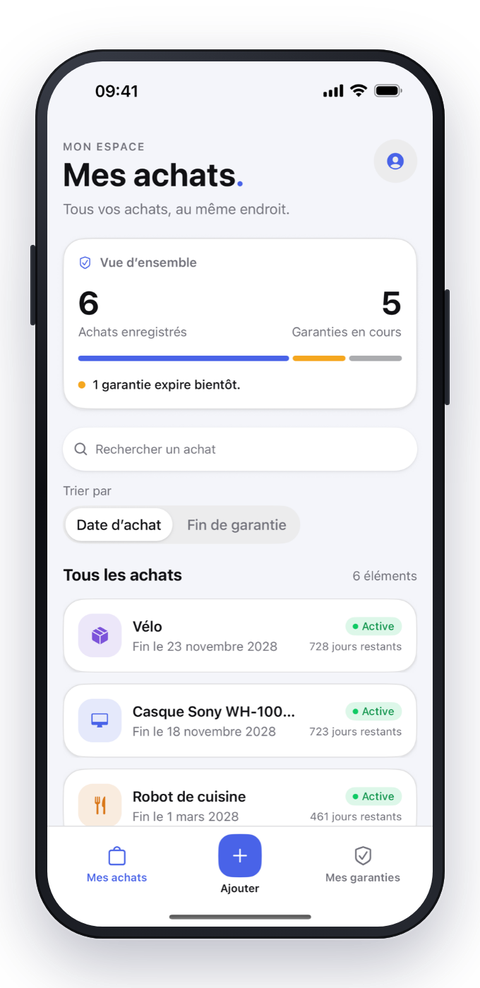
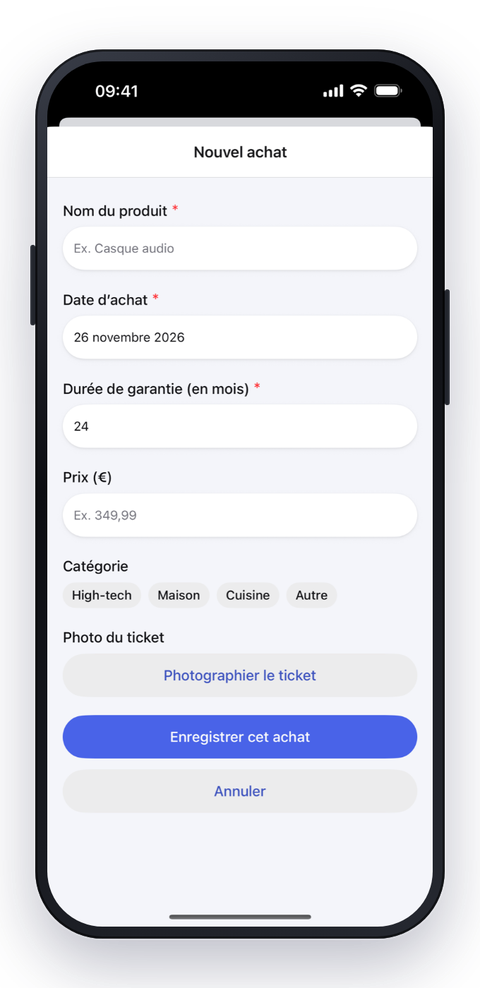
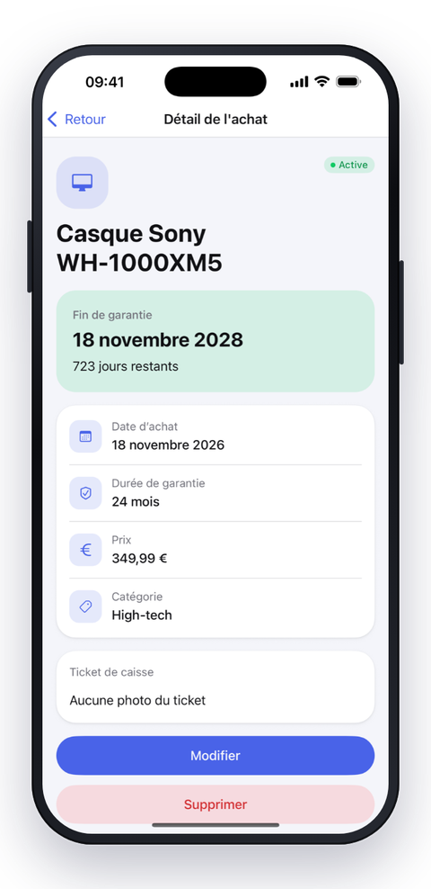
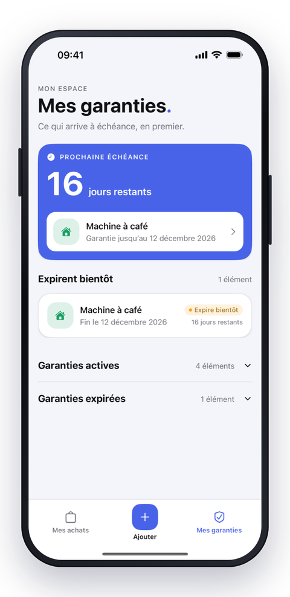

<div align="center">
  
  <h1>GarantiGo</h1>
  <p><strong>Vos achats. Vos tickets. Vos garanties.</strong></p>
  <p>
    Application mobile qui centralise les achats, conserve les tickets de caisse pris en photo<br />
    et suit les dates de fin de garantie.
  </p>
  <p>
    <a href="https://github.com/mathieustrosberg/garantigo-app/actions/workflows/ci.yml"></a>
    
    
    
  </p>
  <p>
    <a href="#fonctionnalités">Fonctionnalités</a> ·
    <a href="#stack">Stack</a> ·
    <a href="#installation">Installation</a> ·
    <a href="#synchronisation">Synchronisation</a> ·
    <a href="#tests">Tests</a> ·
    <a href="#limites-connues">Limites</a>
  </p>
  <br />
  
</div>

<br />

<table>
  <tr>
    <td width="25%" valign="top"><strong>Le ticket, en photo</strong><br />Pris avec la caméra, puis conservé sur le téléphone.</td>
    <td width="25%" valign="top"><strong>La garantie, calculée</strong><br />Date de fin, jours restants et statut, pour chaque achat.</td>
    <td width="25%" valign="top"><strong>Le téléphone d'abord</strong><br />Tout est enregistré sur place : l'application fonctionne sans réseau.</td>
    <td width="25%" valign="top"><strong>Synchronisé</strong><br />Un compte, et on retrouve tout sur un autre téléphone.</td>
  </tr>
</table>

Projet réalisé en binôme dans le cadre du Master 2 Lead Developer Front End.

## Aperçu

<table>
  <tr>
    <td align="center" width="25%"></td>
    <td align="center" width="25%"></td>
    <td align="center" width="25%"></td>
    <td align="center" width="25%"></td>
  </tr>
  <tr>
    <td align="center"><strong>Mes achats</strong><br />Vue d'ensemble, recherche et tri</td>
    <td align="center"><strong>Ajouter</strong><br />Trois champs obligatoires, photo du ticket</td>
    <td align="center"><strong>Détail</strong><br />Fin de garantie et jours restants</td>
    <td align="center"><strong>Mes garanties</strong><br />La prochaine échéance en tête</td>
  </tr>
</table>

Captures prises dans le simulateur iOS. L'interface suit le thème clair ou sombre du téléphone.

## Fonctionnalités

Sans compte connecté, l'application affiche un accueil qui propose de créer un compte ou de se connecter. Une fois connecté, elle compte quatre écrans principaux, reliés par une barre d'onglets (Mes achats, Mes garanties) qui porte aussi le bouton d'ajout. Le détail, le formulaire et le compte s'ouvrent par-dessus.

- **Accueil, connexion, inscription** : adresse e-mail et mot de passe, saisi deux fois à l'inscription. Un message d'erreur s'affiche sous chaque champ invalide, et un échec est expliqué (identifiants incorrects, adresse déjà utilisée, pas de réseau).
- **Mes achats** : vue d'ensemble (nombre d'achats, garanties en cours, répartition par statut), recherche par nom, tri par date d'achat ou par date de fin de garantie, liste des achats avec leur statut. Un état vide distingue « aucun achat » et « aucun résultat ».
- **Ajouter / modifier** : nom, date d'achat (sélecteur natif) et durée de garantie en mois sont obligatoires ; prix, catégorie et photo du ticket sont facultatifs. Un message d'erreur s'affiche sous chaque champ invalide. La photo est prise avec la caméra uniquement, avec un aperçu, « Reprendre » et « Retirer ».
- **Détail** : statut, date de fin de garantie, jours restants (toujours affichés), informations de l'achat, photo du ticket, modification, suppression confirmée.
- **Mes garanties** : la prochaine échéance en tête, puis les achats regroupés par statut. Les garanties qui expirent bientôt sont toujours affichées ; les garanties actives et expirées se déplient d'un appui. Un état vide est prévu.
- **Compte** : adresse du compte connecté, état de la synchronisation, « Synchroniser maintenant » et « Se déconnecter ».

Règles de garantie :

- fin de garantie = date d'achat + durée en mois ; si le jour n'existe pas dans le mois d'arrivée, on prend le dernier jour de ce mois ;
- **active** : plus de 30 jours restants ; **expire bientôt** : de 0 à 30 jours, bornes incluses ; **expirée** : date de fin dépassée.

Un retour haptique confirme l'enregistrement et la suppression d'un achat.

Les achats et les photos des tickets appartiennent à un compte. Ils sont enregistrés sur le téléphone, puis synchronisés en ligne : en se connectant sur un autre téléphone, on les retrouve. L'application reste utilisable sans réseau une fois connecté. Le fonctionnement est décrit dans la section [Synchronisation](#synchronisation).

## Stack

| Outil                                  | Rôle                                      |
| -------------------------------------- | ----------------------------------------- |
| React Native 0.88, Expo SDK 58         | Socle de l'application                    |
| TypeScript (mode strict)               | Typage                                    |
| Expo Router                            | Navigation par fichiers (`src/app`)       |
| HeroUI Native, Uniwind                 | Composants d'interface et styles Tailwind |
| AsyncStorage                           | Persistance locale des achats             |
| Supabase (`@supabase/supabase-js`)     | Comptes et copie en ligne des achats      |
| expo-image-picker                      | Photo du ticket prise avec la caméra      |
| expo-file-system                       | Conservation des photos sur le téléphone  |
| expo-haptics                           | Retour haptique                           |
| @react-native-community/datetimepicker | Sélecteur de date natif                   |
| Jest, jest-expo, Testing Library       | Tests                                     |
| ESLint, Prettier                       | Qualité et formatage du code              |
| GitHub Actions                         | Intégration continue                      |

Les choix techniques sont justifiés dans [`docs/adr`](docs/adr).

## Prérequis

- Node 22 (la version est fixée dans `.nvmrc`).
- pnpm 10 (la version est fixée dans `package.json`, champ `packageManager`).
- Un iPhone sous iOS 16.4 ou plus, avec l'application **Expo Go** installée depuis l'App Store.
- Un compte Expo, connecté à la fois dans le terminal et dans Expo Go.
- Une connexion à Internet pour créer un compte GarantiGo ou s'y connecter la première fois.

Le fichier `.env` du dépôt contient l'adresse du projet Supabase et sa clé publique : il n'y a rien à configurer. Ces deux valeurs ne sont pas des secrets (voir [ADR-005](docs/adr/005-cloud-sync.md)).

## Installation

```bash
git clone https://github.com/mathieustrosberg/garantigo-app.git garantigo
cd garantigo
pnpm install
```

## Démarrage

```bash
pnpm exec expo login   # une seule fois
pnpm start
```

Scanner ensuite le QR code affiché dans le terminal avec l'appareil photo de l'iPhone. Le téléphone et l'ordinateur doivent être sur le même réseau Wi-Fi. Si le réseau bloque la connexion, utiliser `pnpm start --tunnel`.

Une classe Tailwind utilisée pour la première fois n'est pas prise en compte par un serveur déjà lancé, même après un rechargement avec `r`. Dans ce cas, arrêter le serveur (`Ctrl+C`) et le relancer en vidant le cache :

```bash
pnpm start -c
```

## Commandes

| Commande            | Effet                                 |
| ------------------- | ------------------------------------- |
| `pnpm start`        | Lance le serveur de développement     |
| `pnpm typecheck`    | Vérifie le typage TypeScript          |
| `pnpm lint`         | Analyse le code avec ESLint           |
| `pnpm format`       | Formate le code avec Prettier         |
| `pnpm format:check` | Vérifie le formatage sans rien écrire |
| `pnpm test`         | Exécute les tests                     |

## Organisation

```text
src/app/        routes et écrans (Expo Router)
src/components/ composants partagés entre les écrans
src/purchases/  modèle et logique métier des achats
src/storage/    accès au stockage et liste partagée entre les écrans
src/account/    compte utilisateur : connexion, inscription, déconnexion
src/sync/       synchronisation des achats et des photos avec la copie en ligne
src/theme/      couleurs de l'application
src/native/     accès aux fonctions natives du téléphone (caméra, photos, retour haptique)
src/__tests__/  tests des écrans (ils ne peuvent pas être placés dans src/app)
src/data/       achats de démonstration
docs/adr/       décisions d'architecture
docs/           checklist de tests manuels sur iPhone
supabase/       schéma de la base en ligne (table, règles d'accès, dossier des photos)
.github/        intégration continue et modèle de Pull Request
```

## Données

- **Achats** : enregistrés en JSON sous une seule clé AsyncStorage (`garantigo.purchases.v1`). Les écrans passent par l'interface `PurchaseStorage` et ne connaissent pas AsyncStorage ([ADR-003](docs/adr/003-local-persistence.md)).
- **Photos des tickets** : copiées dans le dossier permanent `receipts/` de l'application. L'achat ne garde que le nom du fichier, et la suppression d'un achat supprime sa photo ([ADR-004](docs/adr/004-receipt-photos.md)).
- **Dates** : les dates d'achat sont stockées sans heure (`AAAA-MM-JJ`) et les calculs se font en UTC, pour ne jamais changer de jour selon le fuseau horaire.
- **Achats de démonstration** : cinq achats fournis par un fichier JSON. Ils ne sont enregistrés au premier lancement que si le service en ligne n'est pas configuré ; avec un compte, on démarre sans achat.

## Synchronisation

Le choix de Supabase et les règles ci-dessous sont justifiés dans l'[ADR-005](docs/adr/005-cloud-sync.md).

- **Le téléphone d'abord** : chaque changement est enregistré sur le téléphone, puis envoyé en ligne. Sans réseau, il part à la synchronisation suivante.
- **Quand** : à la connexion, au retour de l'application au premier plan et après chaque ajout, modification ou suppression. L'écran Compte permet aussi de la relancer.
- **Conflits** : le téléphone note la date de chaque changement (clé `garantigo.changes.v1`). Si le même achat a changé sur deux téléphones, la modification la plus récente gagne.
- **Suppressions** : un achat supprimé est marqué comme tel en ligne, pour que les autres téléphones le suppriment à leur tour.
- **Photos** : une photo prise sur un téléphone est envoyée dans un dossier privé du compte, puis téléchargée par les autres téléphones.
- **Un compte par téléphone** : si un autre compte se connecte, la copie du téléphone est vidée puis remplie avec ses achats. Rien ne passe d'un compte à l'autre.
- **Confidentialité** : des règles d'accès dans la base garantissent qu'un compte ne lit et n'écrit que ses propres achats et ses propres photos.

Pour utiliser son propre projet Supabase : exécuter [`supabase/schema.sql`](supabase/schema.sql) dans l'éditeur SQL du projet, désactiver la confirmation de l'adresse e-mail, puis remplacer les deux valeurs du fichier `.env`.

## Tests

Les tests automatiques (Jest, Testing Library) couvrent en priorité :

- le calcul des dates de fin (fins de mois, années bissextiles), les jours restants et le seuil exact des 30 jours ;
- la validation du formulaire ;
- l'ajout, la modification, la suppression et la persistance « après redémarrage » ;
- la recherche et le tri ;
- la prise de photo (permission refusée, prise annulée, copie impossible) et la suppression de la photo ;
- les erreurs de lecture et d'écriture du stockage ;
- la synchronisation, avec deux téléphones simulés sur le même compte : ajout, modification, suppression, conflit, panne de réseau, changement de compte, photos ;
- la connexion, l'inscription et leurs messages d'erreur.

Les tests utilisent une date de référence fixe : ils ne dépendent jamais du jour où ils sont lancés. Le service en ligne y est remplacé par une copie en mémoire.

Un test vérifie la synchronisation contre le vrai projet Supabase. Il est ignoré par défaut et se lance à la main, avec un compte de test :

```bash
SYNC_TEST_EMAIL=... SYNC_TEST_PASSWORD=... pnpm exec jest sync.integration
```

## Intégration continue

À chaque Pull Request vers `main`, GitHub Actions installe les dépendances avec `pnpm install --frozen-lockfile`, puis exécute le typage, le lint, la vérification du formatage et les tests. Aucun secret ni build native n'est nécessaire, et la CI ne contacte aucun serveur.

La caméra, les permissions, le retour haptique, la persistance des photos et la synchronisation entre deux téléphones se vérifient à la main sur iPhone, avec la [checklist de tests manuels](docs/manual-test-checklist.md).

## Limites connues

- L'application se lance dans Expo Go : elle a besoin du serveur de développement pour démarrer. Une fois chargée et connectée à un compte, elle fonctionne sans connexion.
- Le compte est obligatoire, et la première connexion demande du réseau.
- Il n'y a pas de « mot de passe oublié », et la confirmation de l'adresse e-mail est désactivée.
- En cas de conflit, la modification la plus récente gagne : elle peut écraser un changement fait hors ligne sur un autre téléphone. L'arbitrage repose sur l'horloge des téléphones.
- Un autre téléphone ne voit un changement qu'à sa prochaine synchronisation, pas à la seconde.
- Si un autre compte se connecte sur un téléphone, les changements du compte précédent qui n'avaient pas encore été envoyés sont perdus.
- Dans Expo Go, la demande d'accès à la caméra est celle d'Expo Go, avec son propre texte. Le texte en français prévu dans `app.json` ne s'appliquerait que dans une application compilée (development build).
- Après un refus de la caméra, « Ouvrir les Réglages » mène aux réglages d'Expo Go, pas à ceux de GarantiGo.
- Une photo remplacée avec « Reprendre », retirée avec « Retirer », ou prise puis abandonnée avec « Annuler » reste dans le dossier `receipts/` du téléphone sans être utilisée. En ligne, une photo qui ne sert plus est supprimée.
- Chaque modification réécrit toute la liste des achats : adapté à quelques dizaines d'achats, pas à des milliers.
- Les données ne sont pas chiffrées sur le téléphone, et la copie en ligne est hébergée par un tiers (Supabase).
- La durée de garantie est saisie par l'utilisateur : l'application ne détermine pas la garantie légale.
- Les composants qui s'appuient sur une feuille native (`BottomSheet`) ne sont pas disponibles dans Expo Go et ne sont pas utilisés.

## Pistes d'évolution

Hors du périmètre du projet, mais envisageables :

- un development build, pour une application installée de façon autonome, avec sa propre demande de permission ;
- le nettoyage des photos inutilisées dans le dossier `receipts/` du téléphone ;
- des rappels avant la fin d'une garantie (notifications locales) ;
- la réinitialisation du mot de passe et la confirmation de l'adresse e-mail ;
- une synchronisation en temps réel, et un arbitrage des conflits qui ne dépende pas de l'horloge des téléphones ;
- la lecture automatique des informations du ticket (OCR).

## Contribuer

Les règles de branches, de commits et de Pull Requests sont décrites dans [`CONTRIBUTING.md`](CONTRIBUTING.md).
